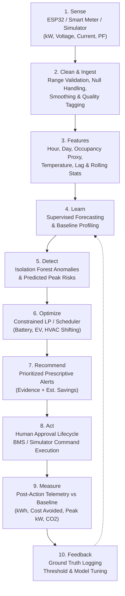

# Fluxora — Master Implementation Plan & Architecture Specification
**PS08 — Energy for the Next Billion**  
*Smarter Energy for a Sustainable Tomorrow*

---

## 1. Executive Summary & Objective

Fluxora is an actionable energy-intelligence and optimization platform designed to eliminate invisible energy waste, coordinate renewables and flexible loads, predict peak demand, detect equipment degradation, execute operator-approved control commands, and verify actual savings against pre-intervention baselines.

This plan operationalizes the 57 pages of **Fluxora_PROJECT_REQUIREMENTS.txt** into a fully functional, production-grade system with:
1. **Frontend**: React executive dashboard built with professional industrial/energy UI standards (neutral slate surfaces, restrained emerald/teal accents, clear typography, zero gimmick neon).
2. **Backend**: Python FastAPI with a clean layered architecture (Routers -> Schemas -> Services -> Repositories -> ML/Optimization).
3. **Data Storage**: Time-series telemetry repository + Relational application database (SQLite out of the box with zero external dependencies, PostgreSQL-compatible via SQLAlchemy).
4. **AI & ML**: Feature engineering engine, 24-48h demand forecaster (XGBoost/GradientBoosting + transparent baseline), and scikit-learn `IsolationForest` anomaly detector.
5. **Optimization Engine**: Constrained load-shifting, battery dispatch, and EV scheduling solver adhering to tariffs and comfort boundaries.
6. **Telemetry & Simulator**: ESP32/CT-sensor HTTP & MQTT ingestion pipeline with data validation and quality flagging, paired with a realistic campus multi-device simulator that dynamically responds to commands.
7. **Savings Verification**: Multi-stage verification (`estimated` -> `measured` -> `verified`) comparing actual post-action telemetry against comparable baselines.

---

## 2. Ten-Stage Operational Workflow

Fluxora implements the complete 10-stage operational loop:



---

## 3. Technology Stack & Directory Structure

- **Backend**: Python 3.13, FastAPI, Uvicorn, Pydantic v2, SQLAlchemy, Scikit-learn, NumPy, Pandas.
- **Frontend**: React 18, Vite, Tailwind CSS, Lucide React, Recharts.
- **Project Structure**:
```
Hackathon/
├── Fluxora_PROJECT_REQUIREMENTS.txt
├── FLUXORA_MASTER_PLAN.md
├── README.md
├── backend/
│   ├── requirements.txt
│   ├── .env.example
│   ├── run.py
│   ├── app/
│   │   ├── __init__.py
│   │   ├── main.py
│   │   ├── core/
│   │   │   ├── config.py
│   │   │   ├── database.py
│   │   │   └── security.py
│   │   ├── models/
│   │   │   └── models.py  # User, Site, Zone, Device, Reading, Alert, Recommendation, Action, Tariff, Report
│   │   ├── schemas/
│   │   │   └── schemas.py # Strictly typed request/response schemas (Appendices A-E)
│   │   ├── repositories/
│   │   │   ├── telemetry_repo.py
│   │   │   └── app_repo.py
│   │   ├── services/
│   │   │   ├── tariff_service.py
│   │   │   ├── telemetry_service.py
│   │   │   ├── recommendation_service.py
│   │   │   ├── action_service.py
│   │   │   ├── savings_service.py
│   │   │   └── report_service.py
│   │   ├── ingestion/
│   │   │   └── cleaner.py # Range validation, quality flags (GOOD, ESTIMATED, ANOMALOUS, STALE)
│   │   ├── ml/
│   │   │   ├── features.py # Temporal, lag, occupancy, weather proxies
│   │   │   ├── forecaster.py # 24-48h demand forecast (XGBoost/GBM + baseline)
│   │   │   └── anomaly.py # Isolation Forest anomaly detection
│   │   ├── optimization/
│   │   │   └── optimizer.py # Constrained battery/EV/HVAC load shifter
│   │   ├── simulator/
│   │   │   └── campus_simulator.py # Interactive multi-device simulator with scenario injection
│   │   └── api/
│   │       ├── auth_routes.py
│   │       ├── telemetry_routes.py
│   │       ├── device_routes.py
│   │       ├── analytics_routes.py
│   │       ├── forecast_routes.py
│   │       ├── anomaly_routes.py
│   │       ├── optimization_routes.py
│   │       ├── savings_routes.py
│   │       ├── report_routes.py
│   │       ├── simulator_routes.py
│   │       └── health_routes.py
│   └── tests/
│       ├── test_telemetry_cleaner.py
│       ├── test_ml_and_anomalies.py
│       ├── test_optimizer.py
│       ├── test_savings.py
│       └── test_api_endpoints.py
└── frontend/
    ├── package.json
    ├── vite.config.js
    ├── tailwind.config.js
    ├── index.html
    └── src/
        ├── App.jsx
        ├── main.jsx
        ├── api/
        │   └── client.js
        ├── components/
        │   ├── Header.jsx
        │   ├── Sidebar.jsx
        │   ├── MetricCard.jsx
        │   ├── PrescriptiveAlertCard.jsx
        │   ├── SimulationBadge.jsx
        │   ├── StatusBadge.jsx
        │   └── Modal.jsx
        └── pages/
            ├── DashboardPage.jsx
            ├── LiveEnergyPage.jsx
            ├── HistoricalPage.jsx
            ├── ForecastPage.jsx
            ├── AnomaliesPage.jsx
            ├── OptimizationPage.jsx
            ├── DevicesPage.jsx
            ├── RenewablePage.jsx
            ├── AlertsPage.jsx
            ├── SavingsPage.jsx
            ├── ReportsPage.jsx
            └── SettingsSimulatorPage.jsx
```

---

## 4. API Contract & Compliance with Master Appendices

- **Appendix A (Telemetry Ingestion)**:
  `POST /api/telemetry/readings`  
  Validates device ID, ISO timestamp, voltage (180-260V), current (0-500A), powerKw (0-1000kW), powerFactor (0.7-1.0), quality tags.
- **Appendix B (Forecasting)**:
  `GET /api/forecast`  
  Returns `{ "model": "xgboost", "version": "forecast-v1", "horizonHours": 24, "points": [...] }`.
- **Appendix C (Anomaly Detection)**:
  `GET /api/anomalies`  
  Returns `{ "deviceId": "hvac-01", "score": 0.91, "severity": "high", "detectedAt": "...", "evidence": { "baselineKw": 28.1, "observedKw": 44.8, "durationMinutes": 18 } }`.
- **Appendix D (Optimization)**:
  `POST /api/optimization/run`  
  Returns `{ "objective": "minimize_cost_and_peak", "actions": [...], "estimatedImpact": { "costAvoided": 8420, "peakReductionKw": 32 }, "constraints": [...] }`.
- **Appendix E (Savings Verification)**:
  `GET /api/savings/verified` & `GET /api/savings/baseline`  
  Returns `{ "status": "estimated" | "measured" | "verified", "baselineKwh": 1200, "actualKwh": 1080, "savingKwh": 120, "costAvoided": 1950, "method": "comparable_period_baseline" }`.
